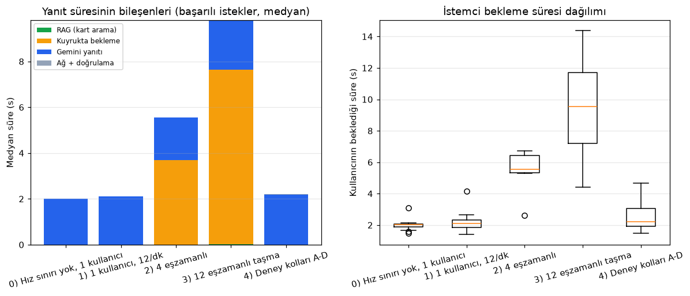
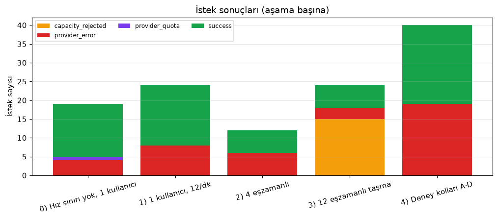

# Gemini Senaryo Üretimi — Stres Testi ve Çıktı Kalitesi

> Sentetik eğitim senaryoları üretimi ölçülmüştür; çıktılar klinik tanı amacı taşımaz.

## Özet

- Toplam 119 istek gönderildi; 63 başarılı (%52.9).
- RAG (kart arama) süresi medyan 3.6 ms; yanıt süresinin neredeyse tamamını Gemini belirliyor.
- Başarılı çıktıların %46.0'i tüm otomatik içerik denetimlerinden geçti (tanı dili yok: %96.8, davranışa uygun: %100.0, dallar farklı: %100.0).
- Darboğaz sunucumuz değil, Gemini'nin dakika başı istek sınırı: hız sınırı olmadan tek kullanıcı ~31 sn'de 18 istek gönderince Gemini 429 QUOTA_EXCEEDED döndü (günlük 1500 kotası değil, dakika sınırı). Öneri: kuyruğa dakika başı hız sınırlayıcı (ör. 12/dk) eklenmeli.
- Gemini geçici aşırı yoğunluk (HTTP 503) hız sınırının altında bile isteklerin %33–50'sinde görüldü. /api/generate-scenario-input 503'te yeniden denemiyor ve yedek modele geçmiyor (26 sahnelik /api/generate-scenario geçiyor). Öneri: 1–2 kez geri çekilmeli yeniden deneme + yedek model.
- Taşma koruması çalışıyor: 12 eşzamanlı istekte kapasite + kuyruk (1+8) dışında kalan 15 istek Gemini'ye gönderilmeden ~25 ms içinde reddedildi; kuyruğa girenler sırayla işlendi.
- Deney kolu D (JSON RAG seçici kural enjeksiyonu), eşik içeren girdilerin 4/4'ünde yaş bandına doğru saniye eşiklerini yazdı (12–18 ay: 2/3 sn; 18–24 ay: 1,8/2,5 sn) ve 6 çıktının 4'üne 'sınırda' dalı ekledi; A, B ve C kollarında hiç eşik yazılmadı. Kol başına başarılı çıktı sayısı küçük (3–6) olduğundan bu sonuç ön bulgudur.
- İçerik: tüm başarılı çıktılar yapı, davranışa uygunluk ve dal ayrımı denetimlerinden geçti; başlıca kusurlar anlatıya yönerge/meta yorum sızması (%40, çoğu 12–18 ay girdisinde) ve Türkçe karakterlerin kaybolması (%21).
- Karışıklık matrisi (96 istek, 10 ontolojiden 3-4'lü 8 kombinasyon, yalnız uyaran sahneleri): istenen risk profili D kolunda (JSON RAG) 22/22 çıktıda tutturuldu (%100; ATİPİK precision 1,0, recall 1,0). A (kural yok) %66,7, B (tek markdown kart) %62,5, C (tüm markdown kartlar) %62,5.
- A/B/C kollarındaki hataların neredeyse tamamı SINIRDA isteklerinde: model 'sınırda' istendiğinde bant eşiğini bilmediği için atipik aralığa taşan gecikmeler yazıyor (SINIRDA→ATİPİK: A 7/8, B 8/8, C 6/8). TİPİK ve ATİPİK istekleri her kolda büyük ölçüde doğru. Markdown kartlar (B/C) yaş bandına özgü sayısal eşik içermediği için A'ya göre iyileşme sağlamadı; farkı yaratan, D kolunun yaş bandına göre seçtiği sayısal eşiklerdir.
- Bu deneyden önce Kol B ve C sunucuda markdown kartları hiç almıyordu (server.js'te eksik require('fs')) ve Δt uyum denetimi hata yutup her zaman 'uyumlu' yazıyordu; ikisi de düzeltildi (commit 2b6d92c), önceki benchmark kayıtlarındaki B/C ve Δt değerleri güvenilir değildir.
- Senaryo sınıf doğruluğu (yalnız uyaran sahneleri, 10 ontolojiden 3-4'lü kombinasyonlar, 94/96 başarılı çıktı): istenen risk profilinin tutturulma oranı genelde %72.3; ATİPİK için precision 0.593, recall 1.0. Kol ayrıntısı 3. bölümde.

### Test ortamı

- **Tarih**: 2026-11-15 00:20–00:55 (sunucu saati)
- **Sunucu**: 31.77.69.171, port 80 (norogelisim.service, development modu), commit 11551da
- **Model**: gemini-3.5-flash-lite (SCENARIO_INPUT_MODEL), ücretsiz katman
- **Kapasite / kuyruk**: GENERATION_MAX_CONCURRENT=1, GENERATION_QUEUE_MAX=8, kuyrukta en çok 60 sn bekleme
- **Girdiler**: 3 sabit girdi: name-young (D01, 12–18 ay), point-middle (D02, 18–24 ay), pretend-older (D04, 24–36 ay)
- **Aşamalar**: 0) hız sınırı yok 1 kullanıcı (kota aşımına kadar); 1) 1 kullanıcı 12 istek/dk; 2) 4 eşzamanlı patlama; 3) 12 eşzamanlı taşma; 4) A/B/C/D deney kolları 10 istek/dk. Aşamalar arası 70 sn bekleme.
- **Sınıf deneyi**: 2026-11-15 03:27–04:25, /api/generate-scenario (stimulusOnly, 11 UYARAN sahnesi), commit 63462e4; model sırası gemini-3.5-flash → yedekler (94 başarılı çıktının 81'i yedek gemini-3.1-flash-lite, 13'ü gemini-3.5-flash ile üretildi; sonuçlar ağırlıklı olarak flash-lite davranışını yansıtır); 8 ontoloji kombinasyonu × 3 risk profili × 4 kol = 96 istek, dakikada 4 istek.

## 1. Performans

| Aşama | Uç nokta | Eşzamanlı | İstek | Başarılı | Hata % | Sonuçlar | İstemci p50 (s) | İstemci p95 (s) | RAG p50 (ms) | RAG p95 (ms) | Kuyruk p50 (s) | Kuyruk p95 (s) | Gemini p50 (s) | Gemini p95 (s) | Verim (istek/dk) |
| --- | --- | --- | --- | --- | --- | --- | --- | --- | --- | --- | --- | --- | --- | --- | --- |
| 0) Hız sınırı yok, 1 kullanıcı | input | 1 | 19 | 14 | 26.3 | provider_error:4, provider_quota:1, success:14 | 1.98 | 3.09 | 2.2 | 3.9 | 0 | 0 | 1.97 | 2.96 | 34.4 |
| 1) 1 kullanıcı, 12/dk | input | 1 | 24 | 16 | 33.3 | provider_error:8, success:16 | 2.03 | 4.16 | 2 | 3.3 | 0 | 0 | 2.02 | 4.15 | 12.3 |
| 2) 4 eşzamanlı | input | 4 | 12 | 6 | 50 | provider_error:6, success:6 | 5.43 | 6.72 | 1.6 | 14 | 3.83 | 5.24 | 1.86 | 2.45 | 38.7 |
| 3) 12 eşzamanlı taşma | input | 12 | 24 | 6 | 75 | capacity_rejected:15, provider_error:3, success:6 | 8.86 | 14.38 | 17.3 | 21.7 | 0 | 14.31 | 2.12 | 2.31 | 84.3 |
| 4) Deney kolları A-D | compare | 1 | 40 | 21 | 47.5 | provider_error:19, success:21 | 2.2 | 3.72 | 4.1 | 6.8 | 0 | 0 | 2.19 | 3.64 | 9.3 |

_capacity_rejected_: kapasite + kuyruk dolu olduğu için Gemini'ye gönderilmeden anında reddedildi. _provider_error_: Gemini geçici hata (ör. 503). _provider_quota_: Gemini kota/hız reddi (429).

## 2. Çıktı kalitesi (otomatik denetim)

- K1 Yapı           — sunucu sözleşme doğrulaması geçti (success)
- K2 Türkçe karakter— Türkçe yazılmış ve Türkçe karakterler korunmuş (ASCII'ye indirgenmemiş)
- K3 Tanı dili yok  — anlatı metninde (başlıklar hariç) otizm / tanı / teşhis / gelişimsel gecikme / atipik / risk vb. yok
- K4 Davranışa uygun— istenen davranışın (D01/D02/D04) temel öğeleri metinde var
- K5 Dallar farklı  — en az iki farklı sonuç dalı; devam metinleri birbirinin kopyası değil
- K6 Yaş tutarlı    — metinde ay/yaş (ör. "30-36 ay") geçiyorsa istenen yaş bandında
- K7 Uzunluk makul  — başlangıç ve dal metinleri çok kısa/uzun değil
- K8 Kart kuralı    — D01'de yetişkin adı tekrar seslenmiyor; D02'de çocuğa dokunup başını çevirmiyor
- K9 Meta sızıntı yok — anlatıya yönerge/meta yorum karışmamış ("taslak önerisi", "uzman incelemesi", "bu senaryoda"...)
- U1 Gözlenebilirlik (uyarı) — iç durum fiilleri (düşünür, hisseder, anlar...) sayısı
- U2 Başlık etiketi (uyarı)  — dal başlığında "Tipik/Atipik" etiketi (sistemin iç etiketi; kullanıcıya gösterilirse gözden geçirilmeli)

### Genel

| Kapsam | Çıktı | K1 Yapı | K2 Türkçe karakter | K3 Tanı dili yok | K4 Davranışa uygun | K5 Dallar farklı | K6 Yaş tutarlı | K7 Uzunluk makul | K8 Kart kuralı | K9 Meta sızıntı yok | Tümü geçti % | İç durum fiili (ort.) | Başlıkta tipik/atipik % |
| --- | --- | --- | --- | --- | --- | --- | --- | --- | --- | --- | --- | --- | --- |
| TÜMÜ | 63 | 100 | 79.4 | 96.8 | 100 | 100 | 92.1 | 100 | 100 | 60.3 | 46 | 0 | 69.8 |

### Girdiye göre

| Girdi | Çıktı | K1 Yapı | K2 Türkçe karakter | K3 Tanı dili yok | K4 Davranışa uygun | K5 Dallar farklı | K6 Yaş tutarlı | K7 Uzunluk makul | K8 Kart kuralı | K9 Meta sızıntı yok | Tümü geçti % | İç durum fiili (ort.) | Başlıkta tipik/atipik % |
| --- | --- | --- | --- | --- | --- | --- | --- | --- | --- | --- | --- | --- | --- |
| name-young (D01) | 21 | 100 | 76.2 | 90.5 | 100 | 100 | 81 | 100 | 100 | 14.3 | 4.8 | 0 | 95.2 |
| point-middle (D02) | 19 | 100 | 84.2 | 100 | 100 | 100 | 94.7 | 100 | 100 | 63.2 | 52.6 | 0 | 47.4 |
| pretend-older (D04) | 23 | 100 | 78.3 | 100 | 100 | 100 | 100 | 100 | 100 | 100 | 78.3 | 0 | 65.2 |

### Deney koluna göre (A: kural yok, B: tek kart, C: tüm kartlar, D: JSON RAG)

| Deney kolu | Çıktı | K1 Yapı | K2 Türkçe karakter | K3 Tanı dili yok | K4 Davranışa uygun | K5 Dallar farklı | K6 Yaş tutarlı | K7 Uzunluk makul | K8 Kart kuralı | K9 Meta sızıntı yok | Tümü geçti % | İç durum fiili (ort.) | Başlıkta tipik/atipik % |
| --- | --- | --- | --- | --- | --- | --- | --- | --- | --- | --- | --- | --- | --- |
| Kol A | 3 | 100 | 100 | 100 | 100 | 100 | 100 | 100 | 100 | 66.7 | 66.7 | 0 | 33.3 |
| Kol B | 6 | 100 | 66.7 | 100 | 100 | 100 | 83.3 | 100 | 100 | 83.3 | 66.7 | 0 | 66.7 |
| Kol C | 6 | 100 | 66.7 | 83.3 | 100 | 100 | 83.3 | 100 | 100 | 66.7 | 33.3 | 0 | 50 |
| Kol D | 6 | 100 | 100 | 100 | 100 | 100 | 100 | 100 | 100 | 66.7 | 66.7 | 0 | 100 |

### Çeşitlilik (aynı girdiye üretilen başlangıçların benzerliği)

| Girdi | Davranış | Yaş bandı | Çıktı | Ortalama benzerlik | Neredeyse kopya (>0,85) % |
| --- | --- | --- | --- | --- | --- |
| name-young | D01 | 12_18 | 13 | 0.29 | 0 |
| point-middle | D02 | 18_24 | 12 | 0.42 | 1.5 |
| pretend-older | D04 | 24_36 | 17 | 0.26 | 0 |

### Denetimden geçemeyen çıktılar (34; ilk 12)

| Aşama | İstek | Girdi | Kol | Başarısız | Ayrıntı | Başlangıç (ilk 160 karakter) |
| --- | --- | --- | --- | --- | --- | --- |
| 0) Hız sınırı yok, 1 kullanıcı | 0 | name-young | — | K2 Türkçe karakter, K9 Meta sızıntı yok | meta: bu senaryoda, klinik esik, taslak onerisi | 12-18 ay araligi icin taslak onerisi olarak duzenlenen bu senaryoda, Deniz evde yerde bloklarla oynamaktadir. Bu yas grubunda gorev basarisi veya klinik esik be |
| 0) Hız sınırı yok, 1 kullanıcı | 3 | name-young | — | K9 Meta sızıntı yok | meta: taslak onerisi, uyarlanmistir | 12 ile 18 ay arasındaki yaş aralığına uygun olarak, bu görev bu yaş grubuna özgü gelişimsel özellikler ve bireysel farklılıklar göz önünde bulundurularak uyarla |
| 0) Hız sınırı yok, 1 kullanıcı | 5 | pretend-older | — | K2 Türkçe karakter |  | Evde cocuk oyuncak bebek ve bos oyuncak fincanla serbestce oynamak uzere haliya oturur. Yetiskin ayni hareketi onceden modellemez ve acik yonerge vermez; kamera |
| 0) Hız sınırı yok, 1 kullanıcı | 6 | name-young | — | K2 Türkçe karakter, K9 Meta sızıntı yok | meta: bu senaryoda, uyarlanmasi | On iki ila on sekiz ay araligina uygun olarak tasarlanan bu senaryoda Deniz evde yerde bloklarla oynamaktadir. Bu yas grubu icin gorevin cocugun gelisimsel duze |
| 0) Hız sınırı yok, 1 kullanıcı | 10 | point-middle | — | K9 Meta sızıntı yok | meta: uyarlanmis | Evde sabit kamera açısı altında masanın solunda kırmızı araba, sağında ise mavi top sabit durmaktadır. On sekiz ila yirmi dört ay aralığına uyarlanmış bu sahned |
| 0) Hız sınırı yok, 1 kullanıcı | 11 | pretend-older | — | K2 Türkçe karakter |  | Evde cocuk oyuncak bebek ve bos oyuncak fincanla serbestce oynar. Yetiskin ayni eylemi modellemez veya acik yonerge vermez. Sabit kamera; eller ve nesneler goru |
| 0) Hız sınırı yok, 1 kullanıcı | 12 | name-young | — | K9 Meta sızıntı yok | meta: taslak onerisi, uyarlanmis | Deniz, evde yerde oturmuş renkli bloklarla oynamaktadır. Sabit kamera, Deniz'in arkasına ve yanına konumlanmış olup hem çocuğu hem de sağ arka çaprazında oturan |
| 0) Hız sınırı yok, 1 kullanıcı | 16 | point-middle | — | K9 Meta sızıntı yok | meta: uyarlanmistir | Evde masanın solunda kırmızı araba, sağında mavi top durur. Yetişkin çocuk başka yere bakarken mavi topu işaret edip Bak der; hedefin adını söylemez. 18-24 ay g |
| 0) Hız sınırı yok, 1 kullanıcı | 17 | pretend-older | — | K2 Türkçe karakter |  | Evde cocuk oyuncak bebek ve bos oyuncak fincanla serbestce oynamak uzere hazir bir masanin basina oturur. Yetiskin ayni eylemi modellemez ve acik yonerge vermez |
| 1) 1 kullanıcı, 12/dk | 1 | point-middle | — | K9 Meta sızıntı yok | meta: uyarlanmistir | Evde sabit kamerayla çekilen sahnede, masanın solunda kırmızı araba ve sağında mavi top görünmektedir. On sekiz yirmi dört ay aralığındaki çocuk başlangıçta baş |
| 1) 1 kullanıcı, 12/dk | 9 | name-young | — | K6 Yaş tutarlı, K9 Meta sızıntı yok | yaş: [12, 18, 30, 36]; meta: bu senaryoda, taslak onerisi, temsili, uyarlanmasi | 12 ile 18 ay aralığındaki çocuk temsili için hazırlanan bu senaryoda, Deniz evde yerde bloklarla oynamaktadır. Taslak önerisi olarak Deniz'in yaşı bu aralıkta k |
| 1) 1 kullanıcı, 12/dk | 12 | name-young | — | K3 Tanı dili yok, K9 Meta sızıntı yok | terimler: tani; meta: temsil eden | Deniz, 12-18 ay aralığını temsil eden bir sentetik çocuk olarak evde yerde bloklarla oynamaktadır. Yaşa uyarlama gereksinimleri doğrultusunda bu görev bu yaş ar |

## 3. Senaryo sınıf doğruluğu (karışıklık matrisi)

Her senaryonun UYARAN sahnelerindeki tepki gecikmeleri (latencySeconds) bilgi tabanındaki yaş bandı eşikleriyle sınıflandı: gecikme ≤ tipik üst sınır → TİPİK, ≥ atipik alt sınır → ATİPİK, arası → SINIRDA; herhangi bir gecikme atipikse senaryo ATİPİK, hepsi tipikse TİPİK, aksi SINIRDA. İkili metriklerde pozitif sınıf ATİPİK'tir (TP: ATİPİK istendi ve ATİPİK üretildi; FP: ATİPİK istenmedi ama ATİPİK üretildi; FN: ATİPİK istendi ama üretilmedi). Bilgi tabanında ATİPİK 'en az X sn gecikme veya hiç tepki yok' olarak tanımlı olduğundan, gecikme yazılmamış ve sahneleri atipik işaretli çıktılar 'tepki yok' senaryosu olarak ATİPİK sayılır; kalan gecikmesiz çıktılar sınıflanamaz ve 'ATİPİK değil' sayılır. Eşikler simülasyon tasarım parametresidir; bu bir tanı doğruluğu değil, üretilen senaryonun istenen profile uyumudur.

### Kol başına metrikler (A: kural yok, B: tek kart, C: tüm kartlar, D: JSON RAG)

| Kol | İstek | Başarılı çıktı | Tepki yok (→ATİPİK) | Sınıflanamadı | 3 sınıf doğruluk % | TP | FP | FN | TN | Precision | Recall | F1 |
| --- | --- | --- | --- | --- | --- | --- | --- | --- | --- | --- | --- | --- |
| A | 24 | 24 | 0 | 0 | 66.7 | 8 | 7 | 0 | 9 | 0.53 | 1 | 0.7 |
| B | 24 | 24 | 0 | 0 | 62.5 | 8 | 8 | 0 | 8 | 0.5 | 1 | 0.67 |
| C | 24 | 24 | 1 | 0 | 62.5 | 8 | 7 | 0 | 9 | 0.53 | 1 | 0.7 |
| D | 24 | 22 | 2 | 0 | 100 | 8 | 0 | 0 | 14 | 1 | 1 | 1 |
| TÜMÜ | 96 | 94 | 3 | 0 | 72.3 | 32 | 22 | 0 | 40 | 0.59 | 1 | 0.74 |

### Sınıf başına doğru sayısı

| Kol | TİPİK doğru | SINIRDA doğru | ATİPİK doğru |
| --- | --- | --- | --- |
| A | 7/8 | 1/8 | 8/8 |
| B | 7/8 | 0/8 | 8/8 |
| C | 5/8 | 2/8 | 8/8 |
| D | 8/8 | 6/6 | 8/8 |

### Kol A

| İstenen ↓ / Gerçekleşen → | TİPİK | SINIRDA | ATİPİK | gecikme yok |
| --- | --- | --- | --- | --- |
| TİPİK | 7 | 1 | 0 | 0 |
| SINIRDA | 0 | 1 | 7 | 0 |
| ATİPİK | 0 | 0 | 8 | 0 |

### Kol B

| İstenen ↓ / Gerçekleşen → | TİPİK | SINIRDA | ATİPİK | gecikme yok |
| --- | --- | --- | --- | --- |
| TİPİK | 7 | 1 | 0 | 0 |
| SINIRDA | 0 | 0 | 8 | 0 |
| ATİPİK | 0 | 0 | 8 | 0 |

### Kol C

| İstenen ↓ / Gerçekleşen → | TİPİK | SINIRDA | ATİPİK | gecikme yok |
| --- | --- | --- | --- | --- |
| TİPİK | 5 | 2 | 1 | 0 |
| SINIRDA | 0 | 2 | 6 | 0 |
| ATİPİK | 0 | 0 | 8 | 0 |

### Kol D

| İstenen ↓ / Gerçekleşen → | TİPİK | SINIRDA | ATİPİK | gecikme yok |
| --- | --- | --- | --- | --- |
| TİPİK | 8 | 0 | 0 | 0 |
| SINIRDA | 0 | 6 | 0 | 0 |
| ATİPİK | 0 | 0 | 8 | 0 |

### Kol TÜMÜ

| İstenen ↓ / Gerçekleşen → | TİPİK | SINIRDA | ATİPİK | gecikme yok |
| --- | --- | --- | --- | --- |
| TİPİK | 27 | 4 | 1 | 0 |
| SINIRDA | 0 | 9 | 21 | 0 |
| ATİPİK | 0 | 0 | 32 | 0 |

### Öz-etiket uyumu (modelin sahnelere koyduğu 'atipik' işareti)

| Kol | TİPİK istendi → öz-etiket TİPİK | ATİPİK istendi → öz-etiket ATİPİK | SINIRDA istendi → atipik işaret var |
| --- | --- | --- | --- |
| A | 8/8 | 8/8 | 8/8 |
| B | 8/8 | 8/8 | 8/8 |
| C | 8/8 | 8/8 | 8/8 |
| D | 8/8 | 8/8 | 5/6 |
| TÜMÜ | 32/32 | 32/32 | 29/30 |

### Ontoloji başına

| Ontoloji | İstek | Başarılı | Gecikme sınıfı doğru % | Öz-etiket doğru % (TİPİK/ATİPİK) |
| --- | --- | --- | --- | --- |
| D01 | 24 | 24 | 79.2 | 100 |
| D02 | 24 | 23 | 60.9 | 100 |
| D03 | 48 | 48 | 68.8 | 100 |
| D04 | 48 | 48 | 70.8 | 100 |
| D05 | 36 | 35 | 65.7 | 100 |
| D06 | 36 | 34 | 76.5 | 100 |
| D07 | 24 | 23 | 78.3 | 100 |
| D08 | 24 | 24 | 70.8 | 100 |
| D09 | 36 | 34 | 76.5 | 100 |
| D10 | 36 | 36 | 69.4 | 100 |

### Uyuşmayan çıktılar (26)

| Kol | Davranış | Yaş (ay) | İstenen | Gerçekleşen | Gecikmeler (s) | Eşikler (s) |
| --- | --- | --- | --- | --- | --- | --- |
| A | D01+D03+D04 | 15 | SINIRDA | ATİPİK | 2.1, 1.5, 4.5, 1.2 | ≤2 / ≥3 |
| B | D01+D03+D04 | 15 | SINIRDA | ATİPİK | 3.2, 2, 4.5, 5, 2.5 | ≤2 / ≥3 |
| C | D02+D05+D06+D09 | 21 | TİPİK | ATİPİK | 1.2, 2.5, 1.8 | ≤1.8 / ≥2.5 |
| A | D02+D05+D06+D09 | 21 | SINIRDA | ATİPİK | 2, 1.5, 3, 0.5, 4, 1 | ≤1.8 / ≥2.5 |
| B | D02+D05+D06+D09 | 21 | SINIRDA | ATİPİK | 1.2, 0.8, 3.5, 1.5, 2.8, 2, 1, 1.2, 0.5 | ≤1.8 / ≥2.5 |
| C | D02+D05+D06+D09 | 21 | SINIRDA | ATİPİK | 2.5, 3.2, 4.1, 1.5, 8 | ≤1.8 / ≥2.5 |
| B | D07+D10+D03 | 30 | TİPİK | SINIRDA | 0.8, 1.2, 1.5, 1.8 | ≤1.5 / ≥2.5 |
| A | D07+D10+D03 | 30 | SINIRDA | ATİPİK | 2.5, 1.2, 3, 2 | ≤1.5 / ≥2.5 |
| B | D07+D10+D03 | 30 | SINIRDA | ATİPİK | 2.5, 1.2, 0.8, 3, 2, 4.5, 1.5 | ≤1.5 / ≥2.5 |
| C | D07+D10+D03 | 30 | SINIRDA | ATİPİK | 2.5, 1.2, 4, 2, 3, 6.5 | ≤1.5 / ≥2.5 |
| A | D08+D04+D05+D06 | 15 | SINIRDA | ATİPİK | 4.2, 2.5, 1.5, 1.2, 3, 5, 2.2, 2, 2.8 | ≤2 / ≥3 |
| B | D08+D04+D05+D06 | 15 | SINIRDA | ATİPİK | 3.2, 1.5, 4.5, 5, 2.8, 1.2 | ≤2 / ≥3 |
| C | D08+D04+D05+D06 | 15 | SINIRDA | ATİPİK | 2, 1.5, 3.5, 4, 2.5, 1, 3 | ≤2 / ≥3 |
| A | D01+D09+D10 | 21 | SINIRDA | ATİPİK | 3.2, 1.1, 2.5, 1.8, 2 | ≤1.8 / ≥2.5 |
| B | D01+D09+D10 | 21 | SINIRDA | ATİPİK | 3.2, 1.5 | ≤1.8 / ≥2.5 |
| C | D01+D09+D10 | 21 | SINIRDA | ATİPİK | 1.2, 4.5 | ≤1.8 / ≥2.5 |
| A | D02+D03+D04+D05 | 30 | TİPİK | SINIRDA | 1.2, 0.8, 0.5, 2, 1, 0.5, 1.5, 1, 0.8 | ≤1.5 / ≥2.5 |
| C | D02+D03+D04+D05 | 30 | TİPİK | SINIRDA | 1.2, 1.5, 0.8, 0.5, 2, 1.8 | ≤1.5 / ≥2.5 |
| A | D02+D03+D04+D05 | 30 | SINIRDA | ATİPİK | 1.2, 2.5, 1.8, 3.4, 2.1 | ≤1.5 / ≥2.5 |
| B | D02+D03+D04+D05 | 30 | SINIRDA | ATİPİK | 2.5, 1.2, 3, 2, 1.5, 2 | ≤1.5 / ≥2.5 |
| C | D02+D03+D04+D05 | 30 | SINIRDA | ATİPİK | 1.2, 0.8, 2.5, 1.5, 2, 5.5 | ≤1.5 / ≥2.5 |
| B | D07+D06+D09 | 15 | SINIRDA | ATİPİK | 1.2, 2.5, 1.5, 3, 5.5, 2 | ≤2 / ≥3 |
| C | D08+D10+D03+D04 | 21 | TİPİK | SINIRDA | 1.2, 0.8, 1.5, 2, 1.8, 0.5, 1 | ≤1.8 / ≥2.5 |
| A | D08+D10+D03+D04 | 21 | SINIRDA | ATİPİK | 4.5, 1.2, 3, 5.5, 3.8, 2.5, 1.5 | ≤1.8 / ≥2.5 |
| B | D08+D10+D03+D04 | 21 | SINIRDA | ATİPİK | 2, 3, 8, 10, 5, 1 | ≤1.8 / ≥2.5 |
| C | D08+D10+D03+D04 | 21 | SINIRDA | ATİPİK | 4.5, 2.2, 1.5 | ≤1.8 / ≥2.5 |

## 4. Elle inceleme

Her girdi ve kol bileşiminden birer örnek olmak üzere 13 çıktı tek tek okundu. Davranışsal içerik genel olarak doğru: istenen nesneler ve yerleşim korunuyor, D01'de yetişkin adı bir kez söylüyor ve çocuğa dokunmuyor, D02'de yetişkin hedefin adını söylemeden işaret ediyor, D04'te yetişkin model olmuyor; tipik ve atipik dallar gözlenebilir davranışla açıkça ayrışıyor. Sorunlar içerikten çok biçimde: yönergedeki notlar anlatıya sızıyor, bazı çıktılarda Türkçe karakterler kayboluyor ve yazım hataları var. Bu kusurlar sentetik video üretimine geçmeden önce düzeltilmeli.

### İyi örnek — D02, 18–24 ay, giriş uç noktası

> Masanın solunda kırmızı araba, sağında mavi top durur. Çocuk başka bir oyuncakla ilgilenip başka yere bakarken yetişkin mavi topu işaret eder ve 'Bak' der, hedefin adını söylemez.

Sahne girdiyle birebir uyumlu, kart kuralı (hedef adı söylenmez) korunmuş; iki dal (hedefe yönelme / yetişkine veya kırmızı arabaya yönelme) yalnız gözlenebilir davranışla anlatılmış.

### İyi örnek — D04, 24–36 ay, kol B

> Çocuk boş oyuncak fincanı eline alır, hafifçe eğerek oyuncak bebeğin ağzına doğru yaklaştırır ve içiyormuş gibi ses çıkararak mış gibi yapma eylemini net bir şekilde canlandırır.

Hayali oyun eylemi kamera ile çekilebilir somut hareketlerle tarif edilmiş; karşı dal (nesneleri rastlantısal yan yana koyma) ayırt edici ve klinik terim içermiyor.

### Meta sızıntı — D01, 12–18 ay, kol C

> Taslak önerisi olarak Deniz'in yaşı 12 ila 18 ay aralığında temsilî olarak seçilmiştir; bu aralık klinik bir eşik veya yaşa dayalı başarı sınırı üretmez. 12-36 ay altındaki uyarlama ekip incelemesi gerektirir.

Sisteme verilen 'bu yaş bandı taslaktır, klinik eşik değildir' notu senaryo metnine kopyalanmış; dal sonlarına 'tanı hükmü içermez' cümleleri eklenmiş. Anlatı yalnız sahneyi anlatmalı. Öneri: yönergeye 'bu notları çıktıya yazma' kuralı eklemek ve sunucuda bu kalıpları doğrulamada reddetmek.

### Türkçe karakter kaybı ve yazım hataları — D01 ve D02

> 12-18 ay araligi icin taslak onerisi olarak duzenlenen bu senaryoda, Deniz evde yerde bloklarla oynamaktadir … Tipik Yonelme Sahnsei / Hedefe Yonelme Gzlendi

Çıktıların yaklaşık beşte biri ASCII'ye indirgenmiş Türkçeyle yazılmış ve 'Sahnsei', 'Gzlendi', 'yetişkene' gibi yazım hataları içeriyor. Kullanıcıya gösterilen metinde kabul edilemez; doğrulamaya 'Türkçe karakter oranı' denetimi eklenmeli veya flash-lite yerine daha güçlü model denenmeli.

### RAG etkisi — D02, 18–24 ay, kol D

> Tipik: 1.8 saniyeden kısa bir sürede … Atipik: 2.5 saniye veya daha uzun süre … Sınırda: 1.8 ile 2.5 saniye arasında tereddütlü bir gecikmeyle hedefe yönelir.

JSON RAG kolu bilgi tabanındaki 18–24 ay eşiklerini (1,8 / 2,5 sn) doğru taşımış ve üçüncü 'sınırda' dalını üretmiş. Diğer kollarda bu sayısal bağ yok; sentetik videoda gecikmenin kurgulanabilmesi için D kolunun çıktısı daha kullanışlı.

### Zayıf örnek — D02, kol A (kural yok)

> Atipik Yonelim: Cocugun dikkati dagilir, yetiskinin isaret ettigi yone bakmaz ve oyuncaklarla ilgilenmez.

Kural enjekte edilmeyen kolda dal metni genel ve kısa; 'dikkati dağılır' gözlenebilir değil, yorum içeriyor. Kart kuralları eklenen kollarda (B/C/D) davranış tarifi belirgin biçimde daha somut.
